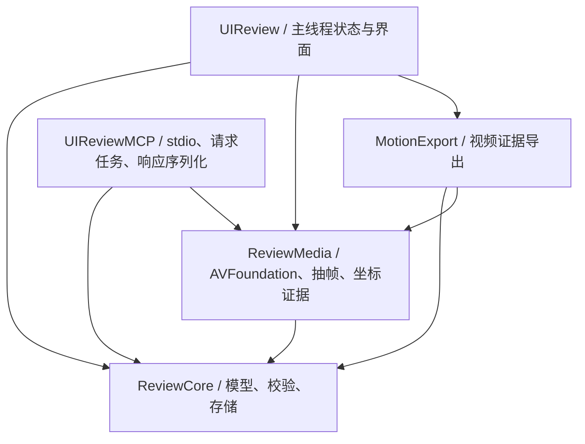

# UI Review V2 技术方案

初版日期：2026-09-08。实现核对日期：2026-10-13，基准为 2.0.6（build 9）。

状态：保留 V2 初始设计依据，并同步当前模型、模块与 MCP 契约。明确标为“原设计”“目标”或“待测”的内容不代表已经实现或通过验收；实现差异在对应章节列出。历史开发证据与截至 2.0.6 的现状见 [开发交付记录](UI_Review_V2_Implementation.md)。

需求依据：[PRD V2.0](UI_Review_PRD_V2.0.md)。本方案保留 macOS 14、Swift Package、SwiftUI + AppKit、本地 stdio MCP，不新增服务端或第三方媒体依赖。

## 1. V2 开发前的 V1 起始状态（历史）

下表记录 2026-09-08 制定方案时的起点与开发计划，不是当前代码缺失项清单。

| 源码位置 | 当时的 V1 状态 | 原定 V2 处理 |
| --- | --- | --- |
| `ReviewCore/Models.swift` | Review 仅含 screenshots，Issue 必须有矩形 | 保留截图类型，新增 Animation 类型及混合顺序 |
| `ReviewCore/ReviewRepository.swift` | 仅接受 schemaVersion=1，原子替换 library.json | 分版本解码、备份迁移、V2 语义验证 |
| `UIReview/ReviewStore.swift` | 主线程保存，成功后才更新 library；保存失败未保留 next | 增加 working/saved revision 和串行保存；失败保留工作副本 |
| `UIReview/AnnotationCanvas.swift` | CanvasView 依赖 Screenshot，鼠标抬起提交区域 | 抽出纯坐标与拖动逻辑，截图适配器保留；视频使用确定帧适配器 |
| `UIReviewMCP/main.swift` | 同步 readLine，参数值只接受 String | 类型化 DTO 校验，异步任务分发及取消；原工具输出做 V1 投影 |
| `UIReview/AgentIntegration.swift` | 要求工具集合恰好等于现有五项 | 必需工具子集检查，区分截图可用与动画可用 |
| `ReviewCore/ReviewExport.swift` | 暂存目录后移动，整份截图 Review 导出 | 复用原子发布，新增选择范围、视频/区域证据与取消 |

设计要求动画与旧截图 Issue 独立建模，并隔离持久化、MCP 与导出契约。当前动画模型独立；旧 MCP 通过 `legacyReview` 移除动画相关字段，帧证据使用 `MotionEvidence`。动画详情与导出仍直接序列化部分持久化模型，尚未做到所有边界各用独立 DTO。

## 2. 模块分工与依赖



当前模块对应如下；初稿的 `LibraryMigration/LibraryValidator/ReviewScope/EvidenceDTO`、`VideoInspector/VideoImporter/FrameIndex/FrameDecoder/FrameRenderer/MediaLimits`、`ReviewExportService`、`MotionTimelineView/FrameAnnotationCanvas` 是设计拟名，并非当前独立文件或类型。

- `ReviewCore`：`MotionModels.swift` 定义 `MediaTime` 等模型，`MotionValidation.swift` 校验动画，`LibraryWriter.swift` 负责迁移与保存事务，`AlignmentEditor.swift` 管理对齐状态。旧图像与截图导出保留在 Core。
- Swift target `ReviewMedia`：`VideoService.swift` 合并视频检查、导入、索引与解码；`MediaCache.swift` 管理内存缓存；`MotionEvidence.swift` 提供证据元数据与图像处理，供 App 和 MCP 共用。
- `MotionExport` 位于 ReviewMedia，复用 Core 的 `ReviewExport` 截图导出能力，Core 不反向依赖 Media。
- App 使用 `MotionStore`、`MotionSession`、`MotionWorkspace`、`MotionPlayerView` 和 `MotionTimelineStrip`；`MotionCanvas` 与 `MotionIssuePanel` 定义于 MotionWorkspace.swift，帧框选复用 `AnnotationCanvas`。对齐状态的纯模型位于 Core 的 `AlignmentEditor`。
- 播放器与 NSView 留在 App；模型与解码服务不引用 ReviewStore，不创建窗口。MCP 退出 App 后仍能独立工作。
- 保持项目当前 Swift 5 language mode；本次不同时升级 Swift 严格并发模式。新增跨任务数据使用值类型，避免把 AVFoundation 对象声明为任意可发送。

## 3. 持久化 Schema v2

### 3.1 库和 Review

`library.json` 根字段：`schemaVersion: 2`、`revision: UUID`、`currentReviewID: UUID?`、`reviews: [ReviewV2]`。每次成功持久化（包括撤销）创建新的 revision。

ReviewV2 保留 `id/title/createdAt/updatedAt/screenshots` 的原结构，新增：

| 字段 | 类型 | 规则 |
| --- | --- | --- |
| animations | `[Animation]` | V1 迁移为 [] |
| videoAssets | `[VideoAsset]` | Review 内的不可变资产目录，包括仍被问题引用的旧参考 |
| itemOrder | `[{kind: screenshot\|animation, id: UUID}]` | 恰好覆盖本 Review 的每个条目一次，无重复或悬空引用 |

截图、动画、视频资产 ID 在库内全局唯一；旧库中合法但跨 Review 重复的截图 ID 不强行改写，旧读取仍按 review_id 定位。V2 新资产分配时检查全库冲突。问题 ID 在所属条目内唯一，所有新接口用 review_id + animation_id + issue_id 解析，不假定问题 ID 全局唯一。

删除动画时调用 `pruneUnusedVideoAssets` 清理未被现存动画或问题引用的资产元数据；它不删除 `assets/videos` 中的物理文件，撤销可恢复元数据。只要旧问题仍引用某参考，该参考元数据与文件都保留。暂不提供自动原视频文件垃圾回收。

### 3.2 媒体时间

JSON `MediaTime = {value: integer, timescale: integer}`，表示秒值 value/timescale。value 限于 ±(2^53−1)，timescale 为 1…2^31−1，保证 JSON 客户端整数精度。拒绝 indefinite、infinity、NaN、非零 epoch 和溢出。

导入记录视频轨道的 `timelineOrigin`，可为负数；用户可见的原视频时间定义为 sample PTS 减 timelineOrigin，从 0 起算。所有问题、对齐起点和 API 请求使用该素材局部时间；解码服务负责转换回 AVFoundation asset time。保留有理数，不用显示的毫秒往返转换。

`TemporalTarget` 为互斥结构：

- 时间点：`{kind: "point", at: MediaTime}`。
- 时间段：`{kind: "range", start: MediaTime, end: MediaTime}`，采用 **[start, end)**，0 ≤ start < end ≤ duration。

帧覆盖终点时取 end 之前最后一个合法样本；不是请求 duration 时伪造末帧。点必须指向有效帧；空区间拒绝。

### 3.3 VideoAsset

| 字段 | 类型/示例 | 用途 |
| --- | --- | --- |
| id | UUID | 资产身份 |
| originalName | String | 展示名称，不用于拼接路径 |
| path | `assets/videos/<UUID>.mp4` 或 `.mov` | 应用分配的相对路径 |
| sha256 / byteLength | hex String / Int64 | 完整性、缓存身份、导出预算 |
| container / codec | mp4\|mov / h264\|hevc | 当前支持白名单，限 SDR |
| trackID | Int32 | 明确选择的唯一视频轨道 |
| timelineOrigin / duration | MediaTime | 时间映射和范围验证 |
| encodedWidth / encodedHeight | Int | 编码像素尺寸 |
| displayWidth / displayHeight | Int | 方向变换后可见帧像素尺寸 |
| preferredTransform | `{a,b,c,d,tx,ty: Double}` | 记录原方向变换 |
| nominalFrameRate | Double? | 展示与诊断，绝不用来构造逐帧时间 |
| colorPolicy | `sdr-srgb-v1` | 派生 PNG 色彩约定 |
| createdAt | ISO8601 | 导入时间 |

当前支持 MP4/MOV 中的 SDR H.264 与 SDR HEVC、0/90/180/270 度方向及镜像。拒绝多视频轨道、受保护内容、非正方形像素、任意仿射变换，以及首帧可见尺寸与元数据不一致的素材；检测到 PQ/HLG HDR 传递函数时明确拒绝，不做自动色调映射。HEVC 已有合成 SDR 样本证据，真实设备录屏、复杂编辑轨道和 clean aperture 等兼容性仍需专项验证。

### 3.4 Animation 与问题

Animation：`id/name/createdAt/updatedAt/currentAssetID/referenceAssetID/activeReference/issues`。

`referenceAssetID` 可为空，记录已导入、尚未对齐的参考资产；`resolvedReferenceAssetID` 优先使用它，旧数据缺少此字段时回退到 `activeReference.referenceAssetID`。`activeReference` 为 null 或 `{referenceAssetID, currentStart, referenceStart, alignmentID}`。

当前对齐在主界面两侧时间轴完成：两侧起点都设置后自动保存，每次更改已配对的起点（点击或拖动结束）创建新的 alignmentID。只设置一侧时保留草稿；取消拖动恢复原位置，不提交。没有独立“确认对齐”步骤。AnimationIssue：

| 字段 | 必填 | 说明 |
| --- | --- | --- |
| id | 是 | 稳定 UUID |
| target | 是 | TemporalTarget |
| comment | 是 | 可为空；空白 trim 后为空即 pending |
| expectation / component | 否 | 用户原始文字 |
| category | 否 | position/scale/opacity/timing/delay/other |
| region | 否 | 零或一个 FrameRegion |
| referenceSnapshot | 否 | 创建或明确更新时复制的参考关系 |

FrameRegion：`assetID/actualTime/frameWidth/frameHeight/pixelRect/normalizedRect`；actualTime 是当前资产的真实样本时间。pixelRect 复用现有 Region，最小宽高 2 px，全部值有限；normalizedRect 与像素推导误差 < 1e−6。一段视频的可见尺寸变化时不沿用旧区域，首版拒绝该素材并说明。

referenceSnapshot 保存 `referenceAssetID/currentStart/referenceStart/alignmentID`。输出时从快照与 target 计算参考时间；移除参考同时清空 Animation 的 referenceAssetID 和 activeReference，不删除问题快照。查看旧关系时显示“此问题使用旧参考关系”，用户选择“使用新的对齐方式”才替换；没有快照的问题可选择“使用当前对齐”。

完整 JSON 示例见 [动画问题示例](examples/motion-issue-v2.json)。示例描述的是一个 AnimationIssue 及其关联资产/参考摘要，不冒充完整 library.json。

## 4. 存储、迁移与保存事务

目录：

```text
UIReview/
  library.json
  backups/library-v1-<UUID>.json
  assets/<existing-screenshot-id>.png
  assets/videos/<asset-id>.mp4
  assets/videos/<job-id>.staging.mp4 # 导入临时文件，完成/失败后清理
  writer.lock
```

路径校验沿用精确 ID 文件名与 resolvingSymlinksInPath 的目录边界检查。客户端不传路径；源名称不作为目标路径。资产使用 exclusive-create 防止覆盖同名文件。

迁移仅由 App 执行，MCP 永不写库：

1. 取得新版本写锁；载入原字节，先读 schemaVersion，再用相应 DTO 解码与校验。
2. V1 校验通过后，将原字节写入唯一备份文件，确认写入完成。保留所有原 ID/截图顺序/当前 Review。
3. 在内存增加 animations/videoAssets=[]、itemOrder=旧截图顺序、revision；不重编码/移动原图。
4. 校验 V2；写同卷临时库，原子替换 library.json。迁移失败不发布 V2，不把坏库替换为空库。
5. 新 MCP 遇到 V1 时只做内存投影，返回动画列表为空；遇更高未知版本则停止读取并报告数据版本不受支持。原设计的 UNSUPPORTED_SCHEMA 独立错误码尚未统一实现，见第 8.3 节。

写锁只约束配合的新版本；不能声称阻止旧 App 写入。当前 `LibraryWriter` 保存前比较磁盘原始字节与上次成功快照，检测外部变化即停止写入并提示重新打开应用。迁移前关闭旧版；回退先退出新 App，再恢复备份，新增资产可以暂留但旧版不可访问。

原设计将保存状态划分为 workingLibrary、savedRevision、editGeneration、dirty/error。当前 `ReviewStore` 使用工作 `library`、`hasUnsavedChanges` 和 revision 比较：编辑先更新工作副本与撤销栈，评论 debounce 300 ms、最多 1 s 提交一次，异步保存完成时确认仍为同一 revision 才清除未保存状态。非合并编辑、撤销/重做、复制与导出通过 `retrySave` 同步保存；串行磁盘事务由 `LibraryWriter` 负责。

失败时工作副本与撤销栈保留，提供重试；MCP 仍看到最后成功快照。交接按钮先等待 flush，失败则不能复制声称包含最新修改的提示词。退出有未保存内容时提示重试或明确放弃，重启只承诺恢复已成功保存的数据。

## 5. 视频导入与资源限额

以下对照原设计目标与 2.0.6 的代码约束。当前没有单一 `MediaLimits` 配置；资源与性能目标仍需专项验证，不能仅凭常量宣称资源验收通过。

| 项目 | 原设计目标 | 当前代码约束/差异 |
| --- | --- | --- |
| 单文件大小 | ≤ 500,000,000 字节 | 已限制，复制期间也检查 |
| 单文件时长 | ≤ 120 秒 | 已限制 |
| 正向帧长边 / 总像素 | ≤ 4096 / ≤ 9,000,000 | 长边已限制；没有独立总像素限制 |
| 支持样本速率 | ≤ 120 fps，VFR 按实际样本间距校验 | 未实施该帧率上限；nominalFrameRate 仅记录与基本有效性校验 |
| 索引样本数 | ≤ 14,401 | 读取循环限制为 36,000 个已记录样本，并设 30 秒索引期限 |
| 单次文件队列 | ≤ 10 | 顺序导入，尚无 10 文件硬上限；取消保留已成功项 |
| 导入并发 / 后台抽帧并发 | 每进程 1 / 2 | App 通过 isBusy 串行导入；MCP 抽帧任务 2 活跃 + 8 等待，App 未使用该 FrameGate |
| App 派生帧内存缓存 | 128 MiB，按实际像素字节计费 | App 与 MCP 各进程共用 MediaCache 实现，帧预算 96,000,000 字节，按 bytesPerRow × height 计费 |
| App 磁盘派生缓存 | 1 GiB LRU | 未实现持久化派生帧缓存 |
| MCP 缓存 | 每进程内存 64 MiB，无持久化写入 | 帧预算为 96,000,000 字节；索引最多保留 8 份，无持久化写入 |
| 空间预检 | 导入 size + 64 MiB；导出估算 + 64 MiB | 未实现独立空间预算预检，实际写入失败会清理本次临时输出 |

当前导入事务：取得 security-scoped 访问 → 验证普通文件/大小 → 在 `assets/videos` 内以唯一 staging 文件分块复制 → 对复制后文件计算 SHA-256、检查轨道/方向、完整解码 PTS 索引与首帧尺寸 → 移入不可变资产路径 → 提交元数据。独立的首/中/末三张图像验证属于原设计目标；当前完整索引与首帧检查不能替代该目标。

当前显示“正在导入”状态，没有真实字节进度。取消检查在分块复制/摘要/索引中执行，并调用 reader/generator 的取消 API；仅清理本次临时文件。库提交失败后的已发布文件保留为孤立文件，不交给 MCP，避免误删其他引用。

## 6. 帧索引、解码与标注坐标

### 6.1 精确帧时间

当前 `VideoService.index` 使用 AVAssetReader 的解码输出，逐个读取有 imageBuffer 的展示帧，保留素材局部 PTS，结束后排序并去重；无效媒体时间和画面尺寸变化会拒绝。原设计还要求记录样本 duration/有效间隔并识别 gap，当前索引只有 PTS 列表，尚未实现该覆盖区间模型。

第一轮实验发现 outputSettings:nil 的压缩读取包含非展示帧项和时间偏移，仅排序无法构造正确索引。因此先采用解码帧基线；若后续优化为压缩索引，必须单独处理样本标记与时间映射并通过相同 oracle 验证。索引耗时尚未测定，长素材仍需后台进度与取消。

下一帧/上一帧从索引找相邻 PTS。当前证据取帧选择不晚于请求时间的最后一个样本，若不存在则回退到首样本；请求必须在 [0,duration)。序列先生成区间候选，再映射到实际帧并去重；它目前不依据样本 duration 检测中间 gap，因此不能承诺所有 gap 都返回 NO_FRAME。

当前 `VideoService.frame` 用 AVAssetImageGenerator，设置 appliesPreferredTrackTransform=true、前后容差 zero。Apple 文档说明零容差请求会增加解码成本，不能据此承诺固定耗时。证据元数据包含 requestedTime、actualTime；App 使用实际返回时间绑定区域，标注图生成时核对 region.actualTime 与解码帧时间。原设计要求对所有返回帧再验证 actualTime 等于索引目标，当前未统一实施这一严格检查。[Apple 精确抽帧说明](https://developer.apple.com/documentation/avfoundation/avassetimagegenerator/requestedtimetolerancebefore)

### 6.2 播放与框选共用画面

播放时使用 AVPlayerLayer；暂停并完成精确取帧后切换为静态画布，区域只在这张稳定图片上编辑。原设计拟用 `FrameIdentity(assetID, actualTime, displayWidth, displayHeight, decoderVersion)` 锁定帧身份；当前没有该独立类型，使用资产 ID、实际帧时间与图像状态绑定区域。

原设计拟新增 FrameCanvasInput。当前 `MotionCanvas` 使用临时 Screenshot/Issue 适配对象复用 CanvasView 的图像、尺寸、区域列表和回调；这些适配对象不写入截图库，区域 CRUD 路由到动画问题。

坐标换算：`scale=min(contentWidth/frameWidth,contentHeight/frameHeight)`；`pixel=(pointer-contentRect.origin)/scale`。起点在黑边/留白不开始绘制，后续拖动 clamp 到帧；反向拖动标准化为 min/max，镜像/旋转已体现在 CGImage 中，不再重复变换。

证据 PNG 可缩小；实际返回 `sourceWidth/sourceHeight/renderedWidth/renderedHeight`，没有 `sourceSize/renderedSize/scale` 字段。矩形先在原帧空间绘制再缩放，像素/归一化坐标仍对应 sourceWidth/sourceHeight，不能拿缩略图尺寸覆盖原帧尺寸。调用方可按两组宽高计算缩放比例。

## 7. 播放同步与 UI 状态机

MotionSession 是 @MainActor 生命周期对象，持有当前/参考 player、播放头、选段与 generation/seekGeneration；参考独立定位使用 referenceSeekID。问题选择由 ReviewStore 管理。SwiftUI body 不创建播放器。

原设计状态图：`idle → loading → paused(frameIdentity) ↔ playing`；定位经过 `seeking`，框选经过 `drawing(preview)`，错误进入 `failed(retryContext)`。当前以 loading/playing、静态帧和错误消息等状态表达，未使用这些枚举状态或独立 FrameIdentity 类型；框选仍依赖暂停后的静态精确帧。

- 切换素材/Review、对齐关系改变、拖动时间轴：递增 generation，取消旧 seek/抽帧。异步完成必须同时验证请求 generation、素材 ID、问题 ID 后才更新画面。
- 原设计要求播放、seek 或切换时取消未完成矩形，保留已保存矩形；Esc 恢复旧区域，mouseUp 验证同一帧身份后提交。当前 MotionCanvas 在资产 ID 或图像对象变化时取消拖动，帧身份并未抽成独立 FrameIdentity 校验类型。
- 双视频采用共享 host time 调度。两个 player 预加载后通过 setRate(_:time:atHostTime:) 在同一 host time 启动；按 Apple 要求设置 automaticallyWaitsToMinimizeStalling=false，自己处理 stall。[Apple 同步播放说明](https://developer.apple.com/documentation/avfoundation/avplayer/setrate(_:time:athosttime:))
- 原设计每 100 ms 检查，阈值为 max(33 ms, 两侧较长帧间隔)。当前主播放器观察周期为 1/30 秒，参考偏差超过 100 ms 时提示并重新定位，恢复沿用原速率；这不等于原设计的误差门槛已通过。
- 暂停比较按同一相对时间分别取得覆盖该时刻的真实帧，允许不同帧率导致 PTS 不同；显示两侧 actualTime。
- 同步范围覆盖两侧可映射的可见区间，某侧越界时显示缺帧/末帧状态，该侧不 seek 到非法时间。

## 8. MCP 契约

### 8.1 旧工具保持 V1 投影

原五工具参数与响应保持截图语义：get_review/get_current_review 继续返回原截图 Review 字段；list_reviews 中 screenshotCount/issueCount 仍为截图计数；get_issues 仍按截图分组。App 自己的总问题数可包含动画，不能复用到旧 MCP issueCount。

新增四个工具形成发现与证据链；initialize.instructions 引导动画任务使用 list_animations，serverInfo.version 升为 2.0.0，协议版本协商保留现有支持列表。

| 工具 | 参数 | 返回 |
| --- | --- | --- |
| list_animations | review_id 可选；limit 默认20、1…100；cursor 可选 | reviewID、libraryRevision、动画摘要（ID/名称/问题数/参考状态）、nextCursor |
| get_animation | review_id、animation_id 必填；expected_revision 可选 | 完整动画、关联视频元数据、问题/参考快照、availability、libraryRevision |
| get_animation_frame | review_id、animation_id 必填；issue_id 或 time（二选一）；source=current\|reference 默认current；variant=original\|annotated 默认original；max_dimension 默认1280、256…2048；expected_revision 可选 | 一份帧元数据 text + 一个 PNG image |
| get_animation_frames | review_id、animation_id、issue_id 必填；source 同上；count 默认3、2…8；max_dimension 默认1024、256…1280；expected_revision 可选 | 有限帧清单 text + 按清单顺序排列的 PNG image，warnings |

参数 time 使用 MediaTime 对象，拒绝字符串毫秒、未知字段、bool 冒充数字和非整数 timescale。variant=annotated 必须指定有 region 的 issue_id 且 source=current；其他组合返回 INVALID_ARGUMENT。

get_animation_frame 的 issue_id 模式：current 有区域时取标注帧，无区域取时间点或范围内首帧；reference 使用该问题的快照映射当前选定时间。time 模式表示所选 source 的素材局部时间；source=reference 且没有 issue_id 时使用 activeReference 的资产，**不**解释为相对时间。

get_animation_frames 仅接受 range 问题，point 返回 USE_SINGLE_FRAME；候选从 start 到区间内最后一个当前样本时间均匀生成，映射实际帧后去重。count 是每个 source 的上限，客户端分别调用 current/reference，并按问题快照映射两侧 requestedTime。成功帧出现在 frames；失败请求单列 failedFrames，不占图片 contentIndex。重复候选只去重，不生成失败项。

所有动画工具的成功响应包含当前 libraryRevision，业务错误没有该字段。调用方可通过 expected_revision 锁定串联读取；磁盘 revision 已变时返回 STALE_REVIEW，不对旧元数据配新图片。cursor 编码 revision/review/last 并验证，库变化使分页失效；不把 cursor 当任意文件路径。

### 8.2 帧响应元数据与预算

单帧和多帧都返回文本对象 `{libraryRevision, frames, requestedCount, returnedCount, failedFrames, warnings}`，随后为 PNG image 内容。每个成功 frame 记录 `assetID/source/requestedTime/actualTime/sourceWidth/sourceHeight/renderedWidth/renderedHeight/coordinateSystem/region`（region 可选）及 `contentIndex`；第一个 PNG 的 contentIndex 为 1，因为文本位于 content[0]。没有 scale 字段。原始媒体路径不供客户端任意读盘；需要完整文件使用 App 导出。

原设计目标是整条 JSON-RPC 响应（含 base64 与元数据）不超过 **12,000,000 字节**。当前实现限制单 PNG 不超过 4,000,000 字节，并检查累计估算 `png.count × 4 / 3` 小于 11,500,000 字节；没有在最终序列化后对完整响应实施 12,000,000 字节硬上限。

当前单图超过 4,000,000 字节时将最大边逐次减半，最低 256，更新 renderedWidth/renderedHeight；不会为缩尺寸单独添加 warning。单帧仍超预算则返回 RESPONSE_TOO_LARGE。多帧按候选顺序处理，超预算/取帧失败记录 `{requestedTime,error}` 到 failedFrames；不再进一步缩图以适应累计预算，也不优先保留首尾，没有 omittedTimes 字段。若至少一帧成功，返回 isError=false；返回数少于候选数时 warnings 给出“重复、缺失或超出预算”的通用提示。全数失败返回 NO_FRAME，具体失败清单不会随该错误返回。

一次最多 8 张，PNG 按实际编码后字节计费，不能用像素估算冒充响应预算。旧 get_screenshot 维持当前 25 MB 原始 PNG 上限，避免此次强改旧契约；更改该限制另行版本化。

### 8.3 任务、取消与只读边界

当前 MCP 在 main.swift 的串行 readLine 循环中读取 stdin，按 request ID 分发 Task.detached；stdout 由输出锁串行写完整 JSON 行。它没有采用原拟定的 @main 异步入口。请求可乱序完成但 ID 保持对应，日志仅 stderr。

同时最多 2 个抽帧任务、8 个等待任务，超额 BUSY；普通元数据请求不排在耗时解码后面。notifications/cancelled 已按请求 ID 取消对应 job，媒体取消处理调用 reader/generator API，任务退出后释放配额。

抽帧单请求超时 15 s、序列 30 s；超时取消 generator，响应 TIMEOUT。不能假设 Task.cancel 会终止底层解码，必须调用媒体取消 API；资源未释放不继续启动无限任务，必要时结束该 MCP 进程由客户端重启。

MCP 不执行迁移，不写库，不写持久化缓存，不修改客户端配置；内存帧缓存按第 5 节实际预算复用。对资产验证存在、大小及内部路径边界；当前每次 EvidenceService.verify 都重算 hash，篡改时报 ASSET_CHANGED。解码缓存键另包含文件身份/mtime/size 和资产摘要；“仅首次校验 hash”是尚未采用的优化设计。

工具业务错误用 isError=true + `{code,message,retryable}` 文本内容，没有 details 字段；JSON-RPC 解析/请求结构错误使用对应 RPC 错误。当前业务 code 从异常消息冒号前的文本提取，未带前缀时回退为 INVALID_ARGUMENT；UNSUPPORTED_SCHEMA/UNSUPPORTED_MEDIA 等原设计独立分类尚未统一实现。单帧失败直接报错，多帧部分成功则 isError=false + failedFrames/warnings，必须检查是否完整。

AgentIntegration 改为验证原五项是工具集合子集，所有公开工具 readOnlyHint=true；动画四项齐全时才显示“动画读取可用”。旧版服务仍可显示“截图可用，动画需升级”，不得把九个工具判为握手失败。同步更新 scripts/test-mcp.py 与连接检测测试。

## 9. 交接与导出实现

复制提示词由 HandoffPrompt 纯函数生成，工具栏提供当前素材（`MotionExport.selected`）与整个 Review 两个复制范围；导出永远是整份当前 Review。复制与导出前执行保存，失败则停止。没有交接预览，含动画的导出另提示将包含完整视频。

复制提示词写明范围与稳定 ID，并要求先读对应元数据再获取原图/标注图；动画可使用 expected_revision 校验。过期提示词仍指向同一对象，若要求的 revision 不再可用则报告变化并重新读取，不能悄悄修复另一个当前 Review。

导出包使用 `formatVersion: 2`，避免混淆持久化 schemaVersion。纯截图旧导出结构由 ReviewExport 保持；含视频时确认完整录屏体积后走 MotionExport.write。全部路径为包内相对路径。

步骤：同卷暂存目录 → 复制原图/完整视频/实际引用旧参考 → 生成原帧与标注帧/序列 → 写 JSON/Markdown → 校验所有引用和字节/hash → 原子移动为最终目录。文件夹只在完整成功时发布，不覆盖已有文件。

用户评论以引用文本输出，文件名和标题转义；不把评论当路径、命令或结构化参数。取消仅删本次 staging；写入失败不删输入数据。派生原帧采用完整可见分辨率输出，MCP 的缩图预算不限制文件导出；导出也按序流式生成，不同时保留所有帧。

## 10. 验证与性能门槛

本机候选基准环境：MacBook Air M4、32 GB、macOS 26.6.1。[T0 第一轮报告](motion-t0-validation.md)已验证四种合成样本共 120 次精确取帧，1080p/60 fps 新建生成器取帧 P95 为 48.88 ms；这不包含索引、冷磁盘与 UI 耗时。仍需 macOS 14、真实录屏、双播放器同步及色彩一致性验证。

| 项目 | 首版验收目标（待测） |
| --- | --- |
| 标准样本 | 10 秒、1080p、SDR H.264，30/60 fps，竖屏和横屏 |
| 冷精确取帧 P95 | ≤ 1 s，至少 30 个不重复时间点 |
| 缓存命中取帧 P95 | ≤ 150 ms |
| 两视频播放 | 标准样本持续 10 s，不出现未提示的持续 >100 ms 漂移 |
| 取消反馈 | UI 在 200 ms 内显示取消中；任务不得继续发布结果 |
| 重复操作 | 100 次素材切换/定位后缓存不超预算，无持续增长的播放器/观察者 |
| 窗口 | 初始 1280×820，最低 1100×760；画布自适应，不裁掉框选/评论/交接入口 |

待完成的真实样本矩阵：30/60 fps、VFR、B 帧、90/180/270 旋转、镜像、文件末尾、非零起始 PTS、长 GOP、损坏中间帧、临界大小/时长、越界参考。SDR HEVC 已进入支持范围，需要扩展真实设备样本；HDR/非正方像素验证明确拒绝。此矩阵与下列测试层次是验收计划，不代表截至 2.0.6 均已执行。

测试分层：

- Core：有理时间比较与半开区间、归一化误差、ID/引用/路径、V1 字节备份、迁移失败、未知版本。
- Store：保存失败保留工作副本、过期保存完成、撤销/重做、跨素材取消、问题范围和区域约束。
- Media：已知 PTS 与角落标记的视频证明方向/取帧/框选一致；索引不使用 nominalFrameRate 推算。
- MCP：真实 stdio 进程的旧五工具投影、九工具检测、数字参数拒绝/接受、响应预算、并发取消、App 退出后取帧、revision 变化。
- Export：包移动后的路径解析、区域图位置、原视频及旧参考完整性、失败/取消不发布。
- UI：实际鼠标绘制、移动、缩放、Esc、R/V、输入框内 Delete、切换时晚回调、同步误差记录。

## 11. 原开发拆分与退出条件（历史计划）

以下为 2026-09-08 的实施批次和阶段门槛；具体交付证据见开发交付记录，不从此表推断测试通过状态。

| 批次 | 文件/职责 | 前置与交付 |
| --- | --- | --- |
| T0 | ReviewMedia 最小验证程序与样本 | 冻结可解码类型、PTS/方向规则和预算；记录真实结果 |
| T1 | Core 模型、V2 validator、migration、DTO | 保留 V1 回归，迁移失败不覆盖旧库 |
| T2 | Store 保存队列、selection、working/saved revision | 保存/撤销状态可验证，未实现视频前截图行为仍通过 |
| T3 | Importer、FrameIndex/Decoder、单视频 UI/框选 | 真拖绘与时间绑定通过 PRD A02–A09 |
| T4 | 参考/对齐/session generation | PRD A10–A13，旧参考快照可追溯 |
| T5 | MCP handlers、probe、复制提示词/导出 | PRD A14–A17，完整 Agent 获取证据闭环 |

当时的阶段约束是不在技术文档阶段改生产模型或迁移真实数据，T0 通过后才能宣称 D0 运行时验证完成。该约束描述历史开发流程；当前资源目标和待测项仍需依据新验证证据更新，不能因版本已发布而自动视为达标。

## 12. 关键决策摘要

- 沿用截图模型，动画独立建模；旧 MCP 保持截图投影，帧证据独立 DTO，全边界 DTO 分离仍为设计目标。
- 稳定帧上框选，不直接在正在变化的播放器画面上保存坐标。
- 有理数时间 + 真实 PTS 索引；对齐只平移，不改变时长。
- 旧 MCP 工具保持截图投影，新增四工具；连接检测支持能力子集。
- App 唯一写者，MCP 不迁移/不写持久化缓存；保存失败保留待保存内容。
- 原素材不可变，历史参考快照保留；输出用 revision 防止混合不同版本证据。
